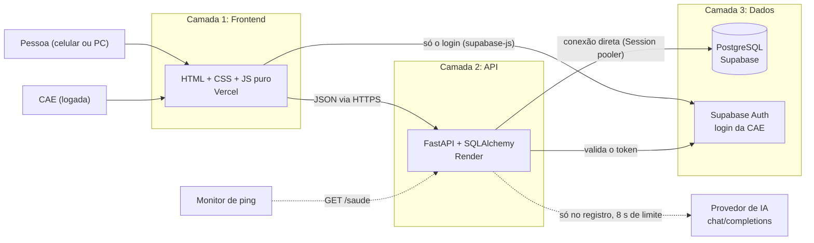

# Arquitetura do Achei Aqui

Portal de achados e perdidos para campi do IFSP. Qualquer pessoa registra e busca itens sem conta; a CAE
(Comissão de Assistência Estudantil) entra com login para ver o contato de quem achou e registrar a devolução.

## As 3 camadas

| Camada | Onde | O que faz | Pasta |
| --- | --- | --- | --- |
| Frontend | Vercel (sem build) | Telas públicas (`index` com busca e filtro por categoria, `registrar`, `item` com o detalhe e o botão Compartilhar) e da CAE (`cae/login`, `cae/painel`). Verde do IFSP e Open Sans. Seletor de campus no cabeçalho (`js/campus.js`): vem de `?campus=` ou da última escolha guardada no navegador; com um só campus ativo, já vem escolhido. Endereços em `js/config.js`. Só fala com a API; usa o Supabase apenas para o login | `frontend/` |
| API | Render | Regras, validação, busca, chamada à IA, autorização da CAE. Camadas internas: `routers` → `services` → `models` (+ `schemas` para entrada e saída) | `backend/app/` |
| Dados | Supabase | Tabelas `campi`, `cae_membros`, `categorias`, `itens`, `devolucoes` (+ `schema_migrations`) e o Auth. RLS ligado, sem policies: a API REST do Supabase não expõe nada | `db/migrations/` |

## Fluxos principais

1. **Escolher o campus** (público): `GET /campi` lista os ativos, com o texto de retirada de cada um (D20, D22).
2. **Registrar achado** (público): `POST /itens` exige o `campus` (sigla) e recusa campus inexistente ou inativo antes
   de chamar a IA. Valida os campos, recusa data no futuro e, se não veio categoria,
   pede uma à IA. Se a IA falhar, demorar mais de 8 s ou responder algo que não é uma categoria, o item é salvo
   sem categoria (D2).
3. **Buscar** (público): `GET /itens?campus=&q=` é o feed de um campus: só itens `disponivel` daquele campus, sem
   contato (D1, D5, D22). `GET /itens/{id}` informa o campus do item.
4. **Login da CAE**: o `supabase-js` faz o login e o frontend envia `Authorization: Bearer <token>`. A API pergunta
   ao Supabase se o token vale (D6) e procura a pessoa em `cae_membros` (D21). Sem token válido: 401; logado mas
   sem linha em `cae_membros`: 403. Todas as rotas `/cae/*` exigem isso e só enxergam o campus da pessoa
   (`GET /cae/campus` diz qual é). Item de outro campus responde 404, como se não existisse.
5. **Devolução** (CAE): `POST /cae/itens/{id}/devolucao` grava a devolução e muda o status na mesma transação.
   Duas devoluções simultâneas do mesmo item: a segunda recebe 409 (`UNIQUE` em `devolucoes.item_id`).
6. **Saúde**: `GET /saude` executa `SELECT 1` no banco. O monitor de ping chama isso (D11).

## Decisões

Cada decisão tem um número (`D##`) que aparece nos comentários do código. O texto completo fica no Memory Bank.

| ID | Decisão | Situação |
| --- | --- | --- |
| D1 | Busca por palavras-chave com `ILIKE`, sem extensão do banco nem API externa | Em uso (muda na Etapa 4) |
| D2 | IA só sugere a categoria no registro; nunca bloqueia o registro | Em uso |
| D3 | Status do item: apenas `disponivel` ou `devolvido` | Em uso (Etapa 3 acrescenta `arquivado`) |
| D4 | Foto reservada (`foto_url`), fora do MVP | Reservada (Etapa 5) |
| D5 | Contato de quem achou só aparece para a CAE | Em uso |
| D6 | Login da CAE pelo Supabase Auth; cadastro desativado, contas criadas à mão | Em uso (com `cae_membros` desde a Etapa 1) |
| D7 | Horário guardado como hora local de Brasília, sem fuso, sem conversão na exibição | Em uso |
| D11 | Monitor externo chama `/saude` para manter API e banco acordados | Em uso (ping pendente na 0.4) |
| D17 | Toda tabela nasce com RLS ligado; o script de migração desfaz a que esquecer | Em uso |
| D18 | Migrações em SQL numerado com runner próprio, sem Alembic | Em uso |
| D19 | Projeto Supabase só para desenvolvimento, separado da produção | Recomendada (projeto pendente na 0.5) |
| D20–D22 | Tabela `campi`; CAE = logado e presente em `cae_membros` (outro campus = 404); público escolhe o campus por `?campus=` | Em uso |
| D23 | Spam vira `status = 'arquivado'`, reversível | A decidir na Etapa 3 |
| D24 | Busca sem acento via coluna de texto normalizado | A decidir na Etapa 4 |
| D25 | Upload de foto: comprimir no navegador; foto de Documentos só para a CAE | A decidir na Etapa 5 |
| D26–D27 | Tabela `perdidos` com link secreto; correspondência por regras e IA, a CAE sempre confirma | A decidir na Etapa 6 |
| D28 | E-mail em segundo plano, só depois da confirmação da CAE e com consentimento | A decidir na Etapa 7 |

D8, D9, D10 e D12 a D16 não aparecem no repositório. Copiar do Memory Bank para esta tabela quando ele for para `docs/`.

## Limites do plano gratuito

Render e Supabase conferidos nas páginas oficiais em 22/10/2026; Vercel e GitHub Actions ainda por conferir
nas páginas deles. Os planos mudam: reconferir antes de cada etapa.

| Serviço | Limite | Efeito no projeto |
| --- | --- | --- |
| Render (API) | Dorme após 15 min sem tráfego; volta em cerca de 1 min; 750 h por mês por workspace; 1 instância; disco apagado a cada reinício; portas de saída 25, 465 e 587 bloqueadas | Primeira visita depois de uma pausa demora. Sem SMTP: o e-mail da Etapa 7 deve usar API HTTP do provedor |
| Supabase (banco e login) | 2 projetos ativos; 500 MB de banco; 1 GB de arquivos; 5 GB de tráfego; 50 mil usuários ativos; **pausa após 1 semana sem atividade**; **sem backup automático** | Precisa de ping e de backup manual (`exportar_dados.py`). Dois projetos: um de produção e um de desenvolvimento, sem sobrar vaga |
| Vercel (frontend) | Plano Hobby: só uso pessoal e não comercial; limite mensal de banda | Adequado a projeto acadêmico |
| Provedor de IA | Cota por minuto e por dia, conforme o provedor e o modelo | Estourou a cota: o item é salvo sem categoria. Registrar provedor e limite no Memory Bank |
| GitHub Actions | Minutos gratuitos por mês (sem limite em repositório público) | CI e DAST rodam a cada PR, a cada push na `main` e toda segunda |

## Como escala

A API não guarda nada em disco nem em memória entre requisições, então crescer é trocar de plano, não reescrever.

1. **Primeiro gargalo: o sono do Render e as 750 h.** Plano pago do Render e do Supabase resolve sem mudar o código.
2. **Mais campi** (Etapa 1): uma coluna `campus_id` e a tabela `campi`, no mesmo banco. Não cria um banco por campus.
3. **Busca**: `ILIKE` percorre a tabela inteira. Com muitos milhares de itens, a Etapa 4 troca por coluna normalizada e índice `pg_trgm`.
4. **Mais de uma instância**: um limite de requisições guardado em memória não vale (cada instância teria o seu). A decisão 001 precisa levar isso em conta.
5. **IA**: a chamada é síncrona e pode segurar o registro por até 8 s. Se o volume crescer, mover para segundo plano.
6. **Banco**: o limite de 500 MB só aperta com fotos (Etapa 5), que vão para o Storage e não para as tabelas.

## Qualidade e segurança na esteira

`ci.yml` (a cada PR, push na `main` e toda segunda): Lint e testes (Ruff, pytest, cobertura), Testes com PostgreSQL 16,
SAST (Bandit e Semgrep), SCA (`pip-audit`) e Segredos (Gitleaks). `dast.yml`: OWASP ZAP contra uma cópia
descartável da API com SQLite, sem tocar no Supabase. Dependabot semanal para `pip` e GitHub Actions.

Na aplicação: a API manda cabeçalhos de segurança em toda resposta (`nosniff`, `X-Frame-Options`, CSP, `no-store`
e outros, com teste no CI), e o site tem CSP e cabeçalhos próprios em `frontend/vercel.json`. Detalhes em
`docs/operacao.md`, seção "Cabeçalhos de segurança e CSP".
